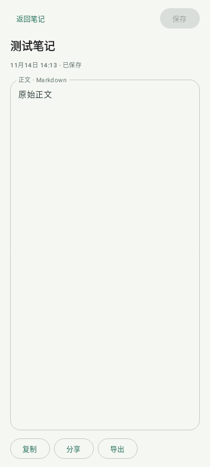
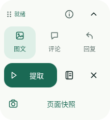
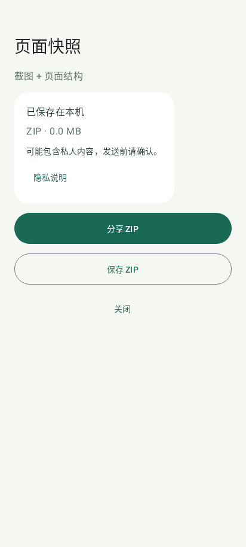

# 粘取 · ZhanQu

**把页面里的文字，变成自己的笔记。**

[GitHub](https://github.com/zzzzzec/ZhanQu) · Android 11+ · 0.3.3

粘取是一款本地文字采集工具：从图文页面整理文字和评论，也可以识别相册里的图片。采集结果留在手机里，随时编辑、搜索、复制或导出。

- **轻点采集**：贴边悬浮入口，选择图文、评论或回复，开始后随时暂停。
- **本地识别**：内置中文 OCR，不申请网络权限。
- **整理成笔记**：保留图页顺序和评论层级，可人工校正。
- **随处使用**：复制、分享，或导出 Markdown、TXT、JSON。

## 开始使用

1. 打开粘取，按首次引导开启“粘取页面采集”无障碍服务。
2. 打开采集入口，切换到小红书图文详情页。
3. 轻点悬浮按钮，选择范围并开始。需要操作页面时先暂停。
4. 采集结束后，在笔记库里查看、编辑或分享。

悬浮入口可以拖动，松手后贴边停靠。单张图片可直接从应用内导入识别，无需开启无障碍服务。

## 界面

界面图由 Android framework 使用合成状态渲染，不包含私人内容。它们用于展示布局，不代表真机采集验收。








## 导出当前页面

打开任意要分析的应用页面，点开悬浮入口，选择“页面快照”。生成后选择“分享 ZIP”或“保存 ZIP”。包内包含当前截图与节点结构，可以发来分析新应用；不会自动翻页或上传。

快照可能包含页面中的私人内容，发送前请核对。[格式与范围](docs/PAGE_SNAPSHOT.md)。



## 更新与数据

0.3.3 修复评论结构节点缺失及部分到底标记无法识别，并拒绝把被裁切的图片记为完整页。新增隔离调试包、真机及模拟器自动测试工具。[本版说明](docs/RELEASE_0.3.3.md)。不同包名使用独立存储；覆盖更新仍需包名和签名一致，不要为更新主动卸载旧版。

0.3.2 预览包沿用 0.2.1–0.3.1 的包名和签名，可作为覆盖更新安装，无需卸载。卸载或清除应用数据会删除内部笔记。

更早的 0.2.0 预览版签名不同，不能直接覆盖。请保留旧版及其数据；导出文件可以独立查看，但当前尚不支持把 JSON 笔记重新导入。原版“粘取”和“粘取预览”使用独立存储。

## 当前支持范围

内置适配面向小红书图文详情页。页面版本、系统与机型会影响采集结果；页面显示的总量与实际采集量分别记录，遇到中断会保存已取得的内容。当前仍为预览版。

只采集你有权保存的内容，分享前检查个人信息。权限用途、数据处理和机型验证集中在[隐私说明](docs/PRIVACY.md)与[测试报告](docs/TEST_REPORT.md)。

## 本地构建

需要 JDK 17 或兼容版本、Android SDK 35。工程固定使用 Gradle 8.11.1、AGP 8.9.2、Kotlin 2.1.20；默认 arm64，minSdk 30 / targetSdk 35。

```sh
./gradlew assembleDebug testDebugUnitTest lintDebug
# 独立预览包
./gradlew assembleDebug -PzhanquPreview=true
```

Windows 使用 `gradlew.bat`。APK 位于 `app/build/outputs/apk/debug/app-debug.apk`。SDK 路径通过 `ANDROID_HOME` 或本机 `local.properties` 配置；签名私钥和本机路径不入库。

## 开发资料

- [架构](docs/ARCHITECTURE.md) · [Profile 规范](docs/PROFILE_SPEC.md)
- [测试报告](docs/TEST_REPORT.md) · [真机清单](docs/TEST_PLAN.md)
- [依赖](docs/DEPENDENCIES.md) · [发布检查](docs/PUBLICATION.md)

测试默认使用合成 fixture。提交问题时请附版本与复现步骤，不要公开私人页面、数据库或密钥。

## 许可

代码公开可查看，但尚未选择通用开源许可证；具体以 [LICENSE](LICENSE) 为准。第三方依赖保留各自许可，`docs/APACHE-2.0.txt` 不代表整个项目的授权。

本项目不隶属于小红书、Google、GKD、Apple 或 Samsung。
