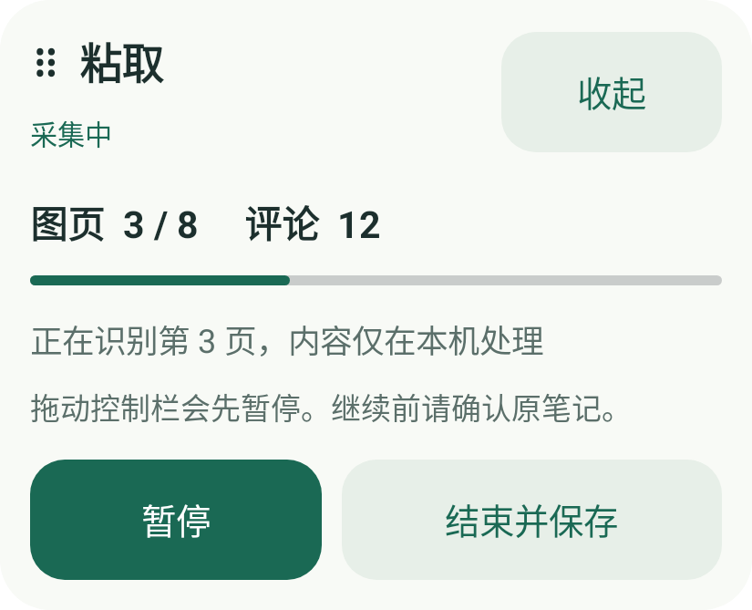

# 粘取 · ZhanQu

**把页面里的文字，整理成自己的本地笔记。**

[GitHub 仓库](https://github.com/zzzzzec/ZhanQu) · 当前开发版本 **0.2.0** · Android 11+

粘取是一款原生 Android 页面文本整理工具。你主动选择页面并开始采集，它通过无障碍节点读取、受检截图与本地中文 OCR，将图文和已加载评论整理为可编辑、可导出的笔记。

- **本地优先**：中文 OCR 模型随应用打包，应用不申请网络权限。
- **过程可控**：手动开始，随时暂停或停止；异常时保留已完成的部分结果。
- **结果可核对**：分开呈现页面宣称总量和实际提取量，不把“没有新内容”当成“全部采集完成”。
- **带走你的文字**：搜索、人工校正、复制、分享，以及 Markdown / TXT / JSON 导出。

> 这是开发测试项目，不是已经完成所有机型验收的正式产品。当前内置适配面向小红书图文详情页，不保证适配所有版本、页面或设备。公开源码不等于已授予开源许可，见下方[许可说明](#许可说明)。

## 界面预览





Android framework 渲染，非真机截图。使用空白笔记库与合成采集进度，不包含个人笔记；实际设备效果可能不同。

## 使用前先了解

需要 Android 11（API 30）或更高版本。默认构建面向 `arm64-v8a`。无障碍权限由你在系统设置中手动开启；粘取不会绕过安全窗口、验证码、访问控制或系统权限限制。

请仅整理你有权访问和保存的内容，遵守来源平台规则及适用法律。页面中可能包含他人信息，导出或分享前请自行核对并脱敏。

## 从第一篇笔记开始

1. 安装自行构建的测试 APK，打开粘取，阅读用途与权限说明。
2. 按应用引导进入 Android 无障碍设置，启用“粘取页面采集”。如果系统限制安装或授权，请按系统说明处理，不关闭安全保护来绕过限制。
3. 显示采集入口，切换到小红书的图文详情页。从悬浮面板选择采集范围，再明确点击开始。
4. 采集期间尽量不要操作手机。需要中断时使用暂停或停止；切换页面、锁屏或出现不安全窗口时，应用也会检查并暂停或停止。
5. 回到粘取查看笔记，核对图页顺序、OCR 文字及评论层级。修正后保存，按需复制、分享或导出。

首次建议用不含个人信息的公开测试内容。评论采集应从可识别的图文详情页开始；如果已滚到评论深处，先回到图文顶部。

### 悬浮控制，不必来回切换

0.2.0 采用浅米色与绿色的卡片界面，把采集状态、统计与本地笔记分开呈现。悬浮面板支持：

- 紧凑状态下暂停 / 继续，展开后查看详细状态及采集范围。
- 拖动标题区调整位置，松手吸附屏幕边缘；拖动时暂停正在进行的采集。
- 开始后收起面板，展开内容可滚动，主要操作按钮保持独立。
- 正在停止和保存时禁用重复操作，避免误触。

笔记编辑增加未保存内容的放弃确认。布局策略与按钮状态有独立 JVM 回归；悬浮窗触摸、旋转、大字体及不同机型的实际表现仍需真机验证。

### 单张图片 OCR

通过系统文件选择器选择一张本地图片，可对比原始 OCR 文字与排版结果。JSON 保留原始文字、排版信息及实际输入尺寸。单图上限 2,000 万像素，超限会拒绝，不静默降低分辨率。

### 更新与数据保留

同包名、同签名且版本允许时才能覆盖安装并保留笔记。不同机器生成的 debug 签名通常不同，不能保证覆盖旧安装。请先导出重要笔记；卸载或清除应用数据会删除内部笔记库。源码不包含签名私钥。

### 并排预览，不替换已有笔记

如果旧版签名不可用，可构建独立的“粘取预览”，与旧应用并存：

```sh
./gradlew assembleDebug -PzhanquPreview=true
```

预览包名为 `dev.zhanqu.app.preview`，无障碍服务名称为“粘取预览页面采集”。它使用独立存储，不会自动迁移或读取原版笔记。为避免两个采集服务相互干扰，请只启用一个服务。预览包仍是测试版本，不是原版的覆盖更新；也不要为安装预览而卸载原应用。

## 它能做什么

| 能力 | 当前范围 |
| --- | --- |
| 图文采集 | 页面元数据、有限轮播、逐页截图与中文 OCR；从中间页开始时尝试验证并回到首页 |
| OCR 排版 | 保留原始文字，按坐标组织同行、换行和分栏；不猜改错字、不补写缺失文字 |
| 评论整理 | 解析已暴露的评论节点，有限滚动和展开，记录父子关系与未确认关系 |
| 本地笔记 | Room 内部存储、搜索、人工校正、部分结果保存 |
| 导出 | Markdown、TXT、JSON；JSON 保留结构化来源与完整性信息 |
| 规则与回归 | 有界 JSON profile、离线 GKD ZIP/JSON 解析器、合成结构测试样本 |

## 边界比“全自动”更重要

- 页码未知、跳页、总数变化、重复截图或 OCR 失败，不会伪装成完整成功。
- 页面显示的评论数不代表所有评论都可读取。去重与无稳定 ID 的父子关系存在启发式限制。
- Android 11–13 与 Android 14+ 的截图能力不同；窗口遮挡检查会根据操作采用不同策略。
- 无障碍触摸事件取决于设备实现，不能保证捕获每一次物理触摸。
- 强制结束进程可能丢失最后一个尚未落盘的结果；重启后不会自动恢复后台手势任务。
- 尚无 UI profile 导入编辑器、PaddleOCR 插件或截图永久留存功能。
- 单元测试不等于真机验收。端到端采集成功率、中文 CER、耗时、内存、OEM 兼容性仍须实际测量。

## 本地构建

准备 JDK 17 或兼容的较新版本、Android SDK Platform 35 和相应 Build Tools。通过环境变量 `ANDROID_HOME` 或本机 `local.properties` 的 `sdk.dir` 指定 SDK；不要提交本地绝对路径。

工程固定使用 Gradle 8.11.1、Android Gradle Plugin 8.9.2、Kotlin 2.1.20，`minSdk 30` / `targetSdk 35`。首次构建需要联网下载工具和依赖；这与应用内 OCR 的本地运行不同。

```sh
# macOS / Linux
./gradlew assembleDebug
./gradlew testDebugUnitTest
./gradlew lintDebug

# Windows PowerShell
.\gradlew.bat assembleDebug testDebugUnitTest lintDebug
```

APK 输出：`app/build/outputs/apk/debug/app-debug.apk`。

默认构建 arm64。如需其他受依赖支持的 ABI，可显式配置，例如：

```sh
./gradlew assembleDebug -PzhanquAbis=arm64-v8a,x86_64
```

这不构成对该 ABI 或模拟器的运行验收承诺。版本号以 `app/build.gradle` 为准。

## 测试与贡献

默认测试使用仓库中的合成文本 fixture，覆盖页码与轮播状态、评论层级、OCR 几何排版、窗口策略、导入边界和导出兼容性。一个可选的本地快照用例在未提供输入时会跳过；这不表示真实页面测试通过，也不影响合成用例运行。

请先阅读[测试说明](docs/TEST_REPORT.md)和[真机验证清单](docs/TEST_PLAN.md)。报告问题时提供应用版本、Android 版本、复现步骤、预期与实际行为；不要在公开 issue、日志或截图中提交账号、页面原文、私有快照、数据库或密钥。

## 工程导航

```text
app/src/main/java/dev/zhanqu/app/
├── MainActivity.kt   首页、笔记与授权引导
├── capture/          无障碍服务、悬浮控制、截图、手势与 OCR
├── core/             Android 无关的规则、解析及校验逻辑
├── data/             本地 Room 笔记存储
└── export/           Markdown / TXT / JSON 导出
app/src/test/         JVM 回归与合成测试数据
docs/                 设计、隐私、测试及发布说明
```

- [隐私与权限](docs/PRIVACY.md)
- [架构与数据边界](docs/ARCHITECTURE.md)
- [JSON Profile 规范](docs/PROFILE_SPEC.md)
- [依赖与来源](docs/DEPENDENCIES.md)
- [公开发布检查清单](docs/PUBLICATION.md)

## 许可说明

原始应用代码尚未选择公共开源许可证，现有 [LICENSE](LICENSE) 不授予通用的使用、修改或再分发许可。仓库公开供查看，不应据此推断为 Apache-2.0、MIT 或其他开源授权。

第三方依赖保留各自许可与条款；`docs/APACHE-2.0.txt` 是第三方许可参考，不是整个项目的许可证。详见[依赖说明](docs/DEPENDENCIES.md)。本项目不隶属于小红书、Google、GKD 或其开发团队。
